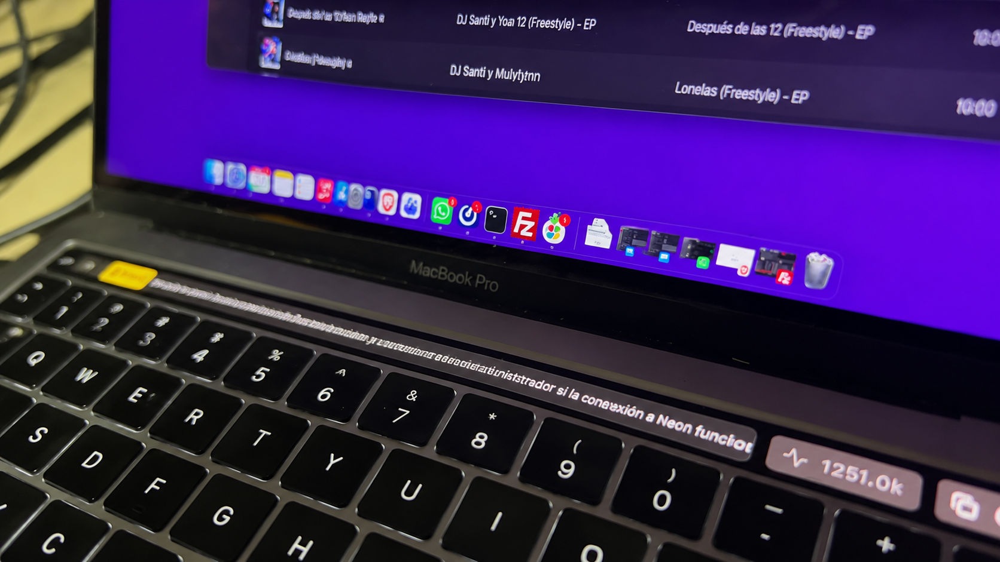

# tbmac

**Codex Touch Bar Companion para macOS**

Aplicación nativa para macOS que observa las sesiones locales de Codex CLI y muestra su actividad en la Touch Bar y en la barra de menús. La aplicación está escrita en Swift y AppKit.

## Así se ve en una MacBook Pro



> Requiere un MacBook Pro con Touch Bar física para ver la interfaz táctil. En otros Mac, la app puede abrirse desde la barra de menús, pero la Touch Bar no está disponible.

## Funciones

- Muestra estados de Codex: pensando, respondiendo, ejecutando herramientas y completado.
- Lee los archivos de sesión JSONL de `~/.codex/sessions` y presenta mensajes y uso de tokens cuando están disponibles.
- Proporciona un panel desde la Touch Bar, el menú de macOS y una demostración visual.
- Permite copiar el último mensaje y ofrece controles de aprobación desde la Touch Bar y atajos de teclado.

La app observa los archivos de sesión locales de Codex. Los controles de aprobación envían una respuesta a la aplicación que está activa; verifica que la terminal correcta tenga el foco antes de usarlos. No incluye una integración de autenticación con Apple Watch.

## Requisitos

- macOS 10.15 o posterior.
- Xcode Command Line Tools (incluye `swiftc`, `codesign` y `hdiutil`).
- Codex CLI instalado y con sesiones guardadas en `~/.codex/sessions` para mostrar actividad real.
- Touch Bar física para las funciones táctiles. El acceso a la Control Strip depende de una API privada de macOS y puede cambiar entre versiones del sistema.

Instala las herramientas de compilación si aún no están disponibles:

```bash
xcode-select --install
```

## Descargar e instalar

En la página **Releases** del repositorio descarga `CodexTouchBar-Installer.dmg` y ábrelo. Arrastra **Codex Touch Bar.app** a **Applications**. Después, abre la app desde Aplicaciones. La distribución está firmada ad hoc, no notarizada; macOS puede requerir que confirmes la apertura desde **Ajustes del Sistema → Privacidad y seguridad**.

## Compilar e instalar desde el código

Clona el repositorio y ejecuta estos comandos desde su carpeta:

```bash
git clone https://github.com/dsantillanAb/tbmac.git
cd tbmac
make build
open CodexTouchBar.app
```

Para instalar una copia en `/Applications` (o `~/Applications` si no hay permisos):

```bash
make install
```

El instalador compila la aplicación, la copia y pregunta si quieres abrirla. También puedes generar el DMG localmente con `make dmg`.

## Uso

Al iniciar, Codex Touch Bar aparece en la barra de menús. Desde su menú puedes mostrar u ocultar el panel, activar la presentación automática, iniciar la demo o copiar el último mensaje. En un Mac con Touch Bar, el botón de Codex abre el panel táctil.

Atajos de aprobación que muestra la app:

| Atajo | Acción |
| --- | --- |
| `fn` + `8` | Aprobar |
| `fn` + `9` | Aprobar siempre |
| `fn` + `0` | Rechazar |

Los atajos globales requieren los permisos de Accesibilidad de macOS. Confirma el foco de la terminal antes de enviar una respuesta.

## Estructura

```text
.
├── Sources/                  # Código Swift de la aplicación
│   ├── AppDelegate.swift     # Inicio, ciclo de vida y coordinación
│   ├── CodexParser.swift     # Interpretación de eventos JSONL
│   ├── CodexSessionMonitor.swift # Lectura de sesiones locales
│   ├── TouchBarManager.swift # Presentación y controles de Touch Bar
│   ├── TouchTickerView.swift # Vista de texto desplazable
│   ├── MenuBarController.swift # Menú de estado de macOS
│   ├── KeyboardShortcutManager.swift # Atajos globales
│   ├── LucideIcons.swift     # Iconos vectoriales
│   ├── LogManager.swift      # Registro
│   └── main.swift            # Punto de entrada
├── Info.plist                # Metadatos del bundle
├── build.sh                  # Compila el bundle .app
├── package_dmg.sh            # Crea el instalador DMG
├── install.sh                # Instala en Applications
├── uninstall.sh              # Desinstala
└── Makefile                  # Comandos frecuentes
```

Los archivos `.app`, `.dmg` y productos de compilación se generan localmente y no forman parte del código fuente versionado. Los releases se publican como DMG.

## Contribuir

Lee [CONTRIBUTING.md](CONTRIBUTING.md) antes de abrir un issue o pull request. Mantén los cambios acotados, explica los cambios visibles para usuarios y no incluyas datos de sesión, credenciales ni archivos de build.

## Licencia

El código de este proyecto se publica bajo **PolyForm Noncommercial License 1.0.0**. Permite estudiar, modificar y distribuir el software para fines no comerciales, incluidos los usos personales definidos por la licencia. No permite el uso comercial bajo estos términos. Esta es una licencia de código disponible, no una licencia de software libre aprobada por OSI.

Consulta [LICENSE](LICENSE) para el texto completo. Los componentes de terceros mantienen sus propias licencias y marcas. Codex y OpenAI son marcas de sus respectivos titulares; este proyecto no está afiliado ni respaldado por OpenAI.

## Aviso

Este proyecto se creó con ayuda de Gemini 3.8 para uso personal y se comparte por si puede ser útil a otras personas. No ha pasado por una revisión exhaustiva y puede contener errores o detalles que podrían mejorarse. Úsalo teniendo esto en cuenta.
